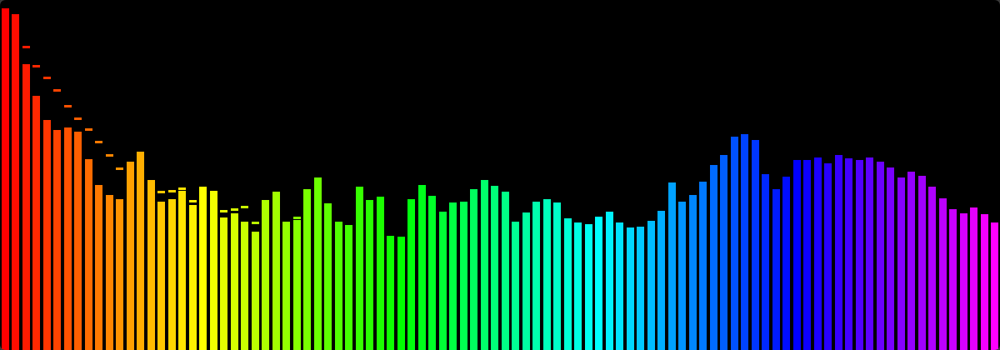

# Spectra



A live spectrum of whatever your computer is playing, in a window of its own
or drawn on your desktop under every window. Black background, colored bars,
nothing else. Resize it, make it full screen, tile it next to your music
player.

It listens to the default output's monitor through `pw-record`, so it shows
what you actually hear, after EasyEffects or any other filter. Colors and
tuning live in a plain config file that applies the moment you save it.

Built for [Omarchy](https://omarchy.org) (Arch, Hyprland, PipeWire), but any
Linux desktop with PipeWire and Qt 6 should do.

## Shortcuts

| Key    | Does                                         |
|--------|----------------------------------------------|
| `?`    | Show or hide the shortcut overlay (also F1)  |
| Space  | Freeze or unfreeze the bars                  |
| `F`    | Full screen on or off                        |
| `L`    | Next layout                                  |
| `P`    | Peak caps on or off                          |
| `G`    | Glow on or off (or click the corner sparkle) |
| `C`    | Switch color mode: spectrum or vertical      |
| `1`-`9`| Apply a preset, in menu order                |
| Ctrl+Q | Quit                                         |

`L`, `P`, `G`, `C` and the presets save their choice to the config file, so
it sticks.

## The corner menu

Hover the sparkle in the top-right corner to open the menu: toggles for
glow, peaks, color mode and layout, then the presets. Clicking the sparkle
itself toggles glow.

## Layouts

`L` cycles through them, or set `[look] layout`:

- `bars`: the classic.
- `mirrored`: bars grow up and down from the middle.
- `radial`: a ring, bass at the top, symmetric left and right.
- `stereo`: left channel up, right channel down.
- `waveform`: the sound wave itself, held steady on tones.

`mode=spectrum` colors across the bands (left to right on the waveform).
`mode=vertical` colors by loudness: bottom to top for bars, center outward
for mirrored, stereo and waveform, ring outward for radial. Peak caps show
on bars, mirrored and stereo.

## Presets

Click a swatch in the corner menu, or press `1`-`9`. Built-ins come first:
Rainbow, Neon, Sunset, Ocean, Fire, Mono. Then come your own,
alphabetically. "Save as preset…" saves the current look and tuning under a
name; hover one of your own and click its x to delete it.

Applying a preset writes its keys into `spectra.conf`, so the file always
shows what's on screen. Keys the preset doesn't set stay as they are.
Built-ins only change `background`, `colors`, `mode`, `peaks` and `glow`.
Your own also restore `gap` and the `[analysis]` keys. Presets never change
the layout.

Your presets live in `~/.config/spectra/presets/<name>.conf`, as partial
INI files with `[look]` and `[analysis]`. You can write them by hand and
they appear in the menu straight away. A preset can't reuse a built-in's
name.

## Wallpaper mode

`spectra --wallpaper` (or **Spectra Wallpaper** in the launcher) draws the
spectrum on the desktop, under every window. Clicks go through to the
desktop. Running it again turns it off. There's no menu, help or keyboard in
this mode; change the look in the config, which applies live. `layer` and
`monitor` are read at startup, so toggle it off and on to apply those.

To start it with Hyprland, add this to `~/.config/hypr/autostart.lua`:

```lua
o.exec_on_start("spectra --wallpaper")
```

(or `exec-once = spectra --wallpaper` in a `hyprland.conf` setup).

## Config

`~/.config/spectra/spectra.conf` is written with the defaults on first run.
Edit it in any editor; spectra picks up the change as soon as the file is
saved. If a value doesn't make sense, spectra uses the default for that key
and says which key in the middle of the window. Keys missing from an older
file just use their defaults.

```ini
[look]
background=#000000
colors=#ff0000, #ffff00, #00ff00, #00ffff, #0000ff, #ff00ff
mode=spectrum
peaks=true
glow=false
layout=bars
gap=0.25

[analysis]
bands=96
fft_size=8192
min_hz=30
max_hz=16000
floor_db=-70
ceiling_db=-3
attack=0.02
decay=0.25
peak_fall=0.6
delay=auto

[capture]
target=
sleep_after=5

[wallpaper]
height=0.35
opacity=0.8
transparent=true
layer=bottom
monitor=
```

### `[look]`

| Key          | Values                    | Meaning |
|--------------|---------------------------|---------|
| `background` | color                     | Window color behind the bars. |
| `colors`     | comma-separated colors    | Gradient stops from low to high. One color gives solid bars. |
| `mode`       | `spectrum` or `vertical`  | `spectrum` runs the gradient across the bands, bass to treble. `vertical` runs it with loudness. |
| `peaks`      | `true` or `false`         | Thin caps that mark each bar's recent peak and drift down. |
| `glow`       | `true` or `false`         | A soft halo around the bars, drawn on the GPU. |
| `layout`     | `bars`, `mirrored`, `radial`, `stereo`, `waveform` | See [Layouts](#layouts). |
| `gap`        | 0 to 0.9                  | Space between bars, as a fraction of a bar's width. |

Colors are anything Qt understands: `#rrggbb`, `#aarrggbb`, or names like
`orange`.

### `[analysis]`

| Key          | Values            | Meaning |
|--------------|-------------------|---------|
| `bands`      | 8 to 256          | Number of bars. |
| `fft_size`   | 512 to 16384, a power of two | Bigger resolves bass better but reacts a little later. |
| `min_hz`     | 1 to 24000        | Lowest frequency shown. Must be below `max_hz`. |
| `max_hz`     | 1 to 24000        | Highest frequency shown. |
| `floor_db`   | -120 to 20        | Level that draws an empty bar. Must be below `ceiling_db`. |
| `ceiling_db` | -120 to 20        | Level that draws a full bar. Lower it if the bars look short. |
| `attack`     | seconds           | How quickly a bar rises. |
| `decay`      | seconds           | How quickly a bar falls. |
| `peak_fall`  | per second        | How fast peak caps fall, as a fraction of the full height. |
| `delay`      | `auto`, or 0 to 2 seconds | Holds the picture back to line up with the sound. `auto` follows the output's own latency: a few ms wired, about 150-250 ms over Bluetooth. |

### `[capture]`

| Key           | Values          | Meaning |
|---------------|-----------------|---------|
| `target`      | an app's name   | Show only that app's sound, like `spotify` or `firefox` (its name or binary, any case). It follows the app across songs and tabs, and the bars stay at zero while it isn't playing. This is the app's sound **before** EasyEffects. Empty shows everything you hear. |
| `sleep_after` | seconds, 0 = never | After this much silence the bars clear and spectra stops drawing until sound comes back. |

Spectra never keeps your audio device awake: its connection is passive, so
the output can suspend whenever nothing plays.

### `[wallpaper]`

Used by `spectra --wallpaper`.

| Key           | Values                     | Meaning |
|---------------|----------------------------|---------|
| `height`      | 0.05 to 1                  | Fraction of the screen the bars fill, from the bottom. |
| `opacity`     | 0 to 1                     | How strongly the bars show over the desktop. |
| `transparent` | `true` or `false`          | Show the desktop wallpaper behind the bars; `false` paints `[look] background`. |
| `layer`       | `bottom` or `background`   | `bottom` sits just above the wallpaper; `background` replaces it. |
| `monitor`     | output name, like `DP-1`   | See `hyprctl monitors`. Empty lets the compositor choose. |

Lines starting with `;` or `#` are comments, and so is anything after a `;`
that follows a space.

## Build and install

You need `qt6-base`, `qt6-declarative`, `qt6-wayland`, `layer-shell-qt`,
`pipewire` (for `pw-record`), `libpulse` (for `pactl`) and `fftw`, plus
`base-devel`.

```sh
bin/build      # builds build/spectra
bin/test       # runs the tests offscreen
bin/install    # makepkg -fsi: installs the binary, launcher entries and icon
```

After `bin/install`, Spectra and Spectra Wallpaper show up in the app
launcher (Super + Space).

## License

MIT. See [LICENSE](LICENSE).
